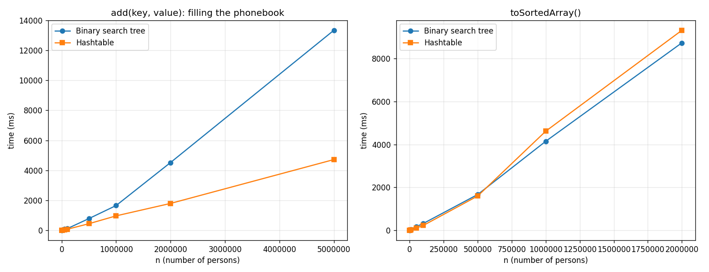

# 05-phonebook report

## Summary

Both fast data structures are implemented as generic classes (`KeyValueHashTable<K,V>` and `KeyValueBSearchTree<K,V>`). They do not reference `Person` or `PhoneNumber` and use only `hashCode`, `equals` and `compareTo` of the key type. All tests pass: `GenericTests`, `ContentsTests`, `HashFuncTests`, `PhoneBookTests`, `PerformanceTestsAdd` and `PerformanceTestsToArray`.

`PhoneBookTests` with 12 345 persons:

| Operation                     | KeyValueArray | Hash table | BST     |
|-------------------------------|--------------:|-----------:|--------:|
| Filling the phonebook         | 4 884 ms      | 9.2 ms     | 13.3 ms |
| Searching                     | 10.0 ms       | 0.024 ms   | 0.026 ms|

Both fast structures fill the phonebook about 400–500 times faster than the linear array, and they search hundreds of times faster. With 5 million persons, filling the hash table took 4.7 s and filling the BST took 13.3 s.

## Performance graph

Data from `compare-add.csv` and `compare-toarray.csv`:

| File            | n         | BST add (ms) | Hash table add (ms) | BST toSortedArray (ms) | Hash table toSortedArray (ms) |
|-----------------|----------:|-------------:|--------------------:|-----------------------:|------------------------------:|
| village.txt     | 100       | 4            | 1                   | 5                      | 1                             |
| small-town.txt  | 1 000     | 5            | 1                   | 3                      | 1                             |
| town.txt        | 10 000    | 20           | 9                   | 34                     | 18                            |
| large-town.txt  | 50 000    | 90           | 40                  | 175                    | 113                           |
| city.txt        | 100 000   | 108          | 69                  | 319                    | 227                           |
| large-city.txt  | 500 000   | 782          | 440                 | 1 670                  | 1 601                         |
| metropolis.txt  | 1 000 000 | 1 652        | 964                 | 4 150                  | 4 620                         |
| capital.txt     | 2 000 000 | 4 522        | 1 794               | 8 735                  | 9 319                         |
| megalopolis.txt | 5 000 000 | 13 341       | 4 718               | –                      | –                             |

(The `toSortedArray` test does not use the megalopolis file.)

### Time complexity

* **Hash table add**: the curve is close to a straight line. Each `add` is O(1) on average, so filling n persons is O(n). Reallocation only adds a constant factor overall, because the table grows geometrically and each element is rehashed O(1) times on average. Going from 1M to 5M persons (5× more) took 4.9× longer, which fits O(n). The small files (100–10 000 persons) take only a few milliseconds, so their times are mostly JIT warm-up and measurement noise.
* **BST add**: the curve bends slightly upwards. Each insert costs O(depth), and the depth grows like O(log n) for this randomly ordered data (see below), so filling is O(n log n). Going from 2M to 5M persons (2.5× more) took 3.0× longer. That ratio is consistent with n log n, plus cache misses because the nodes are scattered around the heap.
* **toSortedArray**: both are dominated by the sort. Collecting the elements is O(n) and quicksort is O(n log n) on average, so the two structures perform almost the same (8.7 s for the BST and 9.3 s for the hash table with 2 million persons). `Person.compareTo` builds two full-name strings on every comparison, and those allocations take most of the sort time.

## Hash functions

`Person.hashCode` uses the djb2 algorithm (`hash = hash * 33 + c`, starting from 5381). It runs over the same characters that `equals` and `compareTo` use: the last name, a space, then the first name. As a result, persons that are equal always get the same hash. The hash is cached in the `Person` object after the first call. Both data structures call `hashCode` many times for the same keys, and the names never change.

I compared four hash functions on `city.txt` (100 000 persons):

| Hash function             | Distinct hashes | Collisions at fill 0.3 | Collisions at fill 0.5 | Collisions at fill 0.7 | Worst probe at 0.7 |
|---------------------------|----------------:|-----------------------:|-----------------------:|-----------------------:|-------------------:|
| Sum of characters         | 2 665           | 97 438                 | 97 528                 | 97 583                 | 3 767              |
| djb2 (×33)                | 99 997          | 15 084                 | 25 025                 | 34 987                 | 62                 |
| Java `String` style (×31) | 99 999          | 15 034                 | 24 954                 | 34 958                 | 82                 |
| FNV-1a                    | 99 993          | 15 053                 | 24 874                 | 35 248                 | 71                 |

* **Sum of characters** is a terrible hash. Anagrams and names of similar length give the same sum, so 100 000 persons got only 2 665 different hash values. Almost every insert collided, and linear probing degenerated into long scans. On the 5 million file this was so slow that I had to stop the experiment.
* **djb2, ×31 and FNV-1a** are practically equal. Each gives almost one distinct value per person, and the collision counts match what a random hash would give at that fill rate. I kept djb2.
* The hash table does not use `hashCode() % capacity` directly. It first runs the hash through a bit mixer (the MurmurHash3 finalizer) in `indexFor`. With good hashes like djb2 this changes very little. With weak hashes (like the test class `Owner`, which sums characters) it spreads the values more evenly. With the sum hash, the worst probe dropped from 99 694 to 954–3 767.

## Fill factors and reallocation

The table uses the given `LOAD_FACTOR = 0.45`. The array is reallocated when `count * 1.45 >= capacity`, which means it grows once it is about 69% full. Each time it grows by about 1 / 0.45 × 1.45 ≈ 3.2×. After the final reallocation, the fill rate of the table is therefore somewhere between about 22% and 69%. In the test runs it was 29–58%:

| File            | Capacity   | Fill rate | Collisions | Worst probe | Reallocations |
|-----------------|-----------:|----------:|-----------:|------------:|--------------:|
| town.txt        | 31 726     | 31.5%     | 1 563      | 9           | 6             |
| city.txt        | 329 397    | 30.4%     | 15 187     | 12          | 8             |
| metropolis.txt  | 3 420 030  | 29.2%     | 146 051    | 14          | 10            |
| capital.txt     | 3 420 030  | 58.5%     | 584 412    | 77          | 10            |
| megalopolis.txt | 11 020 095 | 45.4%     | 1 134 947  | 36          | 11            |

(Collisions are counted for the last fill after the final reallocation, because `reallocate` resets the counters before reinserting.)

The experiment above shows the trade-off clearly. At a fill rate of 0.3 about 15% of inserts collided, at 0.5 about 25%, and at 0.7 about 35%. The worst probe sequence grew from around 10–17 to 60–80. A lower fill rate is faster but wastes memory: at 30% fill, 70% of the array slots are `null`. With 5 million persons that is about 6 million empty references (around 24–48 MB). That is acceptable compared to the memory used by the `Person`, `PhoneNumber` and `Pair` objects. Growing the table by about 3.2× at a time means there are only 11 reallocations for 5 million persons. Each reallocation rehashes every element, but because the sizes grow geometrically, the total reallocation work is still O(n). `compress()` can be used to shrink the array afterwards if memory matters more than speed.

## Collision handling

**Hash table**: open addressing with linear probing. If the slot is taken by a different key, the next slot is tried, wrapping around at the end of the array. No linked lists are used. Linear probing is simple, and because the array is never full, both `add` and `find` always end. It is also cache-friendly, because the probe sequence reads neighbouring array slots. Quadratic probing or double hashing would reduce clustering, but they need table sizes that are powers of two or primes to guarantee that every slot is visited. The bit mixer plus the moderate fill rate already kept the worst probe sequences short (36 steps with 5 million persons). Before probing further, a key is compared by hash first (cheap int comparison) and only then with `equals`.

**BST**: keys are ordered by hash value first, and by `compareTo` only when two different keys have the same hash. This is a strict total order, so colliding keys simply become separate nodes in the tree, and the linked list in `TreeNode` is not needed. That is why `getStatus` reports a longest collision chain of 0. Comparing ints is much cheaper than comparing persons with `compareTo`, which creates two new strings on every call, so this ordering makes inserts and searches faster. The `HashFuncTests` test (two `Owner` objects with the same hash) passes. `add` and `find` are iterative, so a deep tree cannot overflow the stack. Duplicate keys are not searched for first: `add` walks down once and either updates the value of an existing node or creates a new node at the leaf. A new node is only allocated when it is really needed.

## BST depth

| File            | n         | Max depth | log2(n) |
|-----------------|----------:|----------:|--------:|
| village.txt     | 100       | 13        | 6.6     |
| town.txt        | 10 000    | 28        | 13.3    |
| city.txt        | 100 000   | 39        | 16.6    |
| metropolis.txt  | 1 000 000 | 47        | 19.9    |
| megalopolis.txt | 5 000 000 | 60        | 22.3    |

The tree is not balanced, but it stays close to the 2–3 × log2(n) that is expected for random insertion order. The hash values are essentially random, so ordering by hash shuffles the input, even if the data file were sorted by name. Ordering by name alone would make the tree degenerate into a linked list (depth n) for sorted input. The shortest path from the root to a leaf is only 5–8 nodes, which shows how uneven an unbalanced BST is. A self-balancing tree (AVL or red-black) would keep the depth at about log2(n).

## getStatus output

* **Hash table**: capacity, fill rate, number of collisions, the worst probe sequence and the number of reallocations. The collision count and worst probe show directly how good the hash function is. With the sum-of-characters hash both exploded, while with djb2 they matched the theoretical values for random hashing. The fill rate shows the memory waste.
* **BST**: max depth when adding, shortest and longest root-to-leaf paths, and the ideal height. The max depth is the worst-case number of comparisons for `add` and `find`, so it describes search cost directly.

## Sorting algorithm

`Algorithms.fastSort` is a quicksort:

* Median-of-three pivot selection and Hoare partitioning. This handles already sorted data and many equal keys well.
* Insertion sort for small partitions (16 elements or fewer).
* Recursion only into the smaller partition, with a loop for the larger one. Recursion depth is therefore O(log n) even in a bad case, and no extra stack size was needed for 2 million elements.

Quicksort sorts in place and has good cache behaviour, so on this data it is usually faster than heapsort. Heapsort guarantees O(n log n), but it jumps around the array, which causes more cache misses. Merge sort would need an extra array of n elements. With the default JVM heap (4 GB on this machine), all tests ran without changing heap or stack size.
